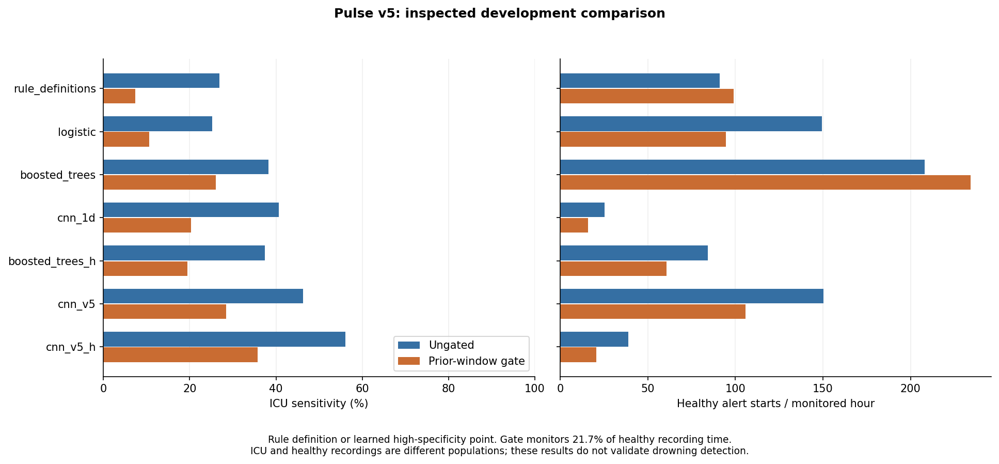

# Completed audit and development runs: 2026-11-16

Notebook 04 v5 completed its full local run, including 216 learned fits,
five-fold nested cross-validation, and the eight full healthy comparison
recordings. Notebook 03 v5 also completed. The published code cells match the
executed local scripts; original v4 notebooks are preserved in the archive.

**The inherited rule selects `cnn_1d` at `high_specificity`.**
Its ungated ICU sensitivity is 40.7%, falling to
20.3% with the prior-window gate. Its gated healthy
false-alert rate is 15.85 starts per monitored hour, while the
gate monitors only 21.7% of recording time.
This is a provisional research selection, not a firmware deployment result.
This research work enabled no new model or automatic pump behavior.

## Pulse comparison and selection

The rule was retained without outcome-driven changes: require ungated ICU
sensitivity at least equal to `rule_definitions`, then minimize gated healthy
alert starts per monitored hour, breaking ties by AUROC. It mixes ungated
sensitivity with gated false alarms. See [the exact selection](firmware_selection.json)
and [fixed run plan](pulse_run_plan.json).

The rule's eligibility floor is only 26.8%
sensitivity. Learned rows below use their inner-CV high-specificity operating
point; that name does not guarantee 90% specificity in outer validation.
All seven original baseline rows reproduce v4, including confidence intervals
and confusion counts ([verification](baseline_reproduction.json)).

| Model | AUROC | ICU sensitivity | ICU specificity | Sensitivity with gate |
|---|---:|---:|---:|---:|
| `rule_definitions` | — | 26.8% | 89.3% | 7.3% |
| `logistic` | 0.694 | 25.2% | 89.5% | 10.6% |
| `boosted_trees` | 0.786 | 38.2% | 90.8% | 26.0% |
| `cnn_1d` | 0.693 | 40.7% | 89.3% | 20.3% |
| `boosted_trees_h` | 0.762 | 37.4% | 89.0% | 19.5% |
| `cnn_v5` | 0.783 | 46.3% | 89.3% | 28.5% |
| `cnn_v5_h` | 0.774 | 56.1% | 85.2% | 35.8% |

These are 514 ICU records, including 123 expert-confirmed alarms. Patient IDs
are unavailable, so folds are record-level. Confidence intervals and per-alarm
results are in [the CV table](pulse_cv_results.csv) and
[alarm-type table](pulse_cv_per_alarm_type.csv).

WildPPG alarms are counted as false under its healthy-volunteer protocol;
there are no adjudicated cardiac-event labels in that dataset.
The healthy comparison contains 108.836 hours from eight people.
The prior-window gate leaves 23.601 monitored hours. Gated flagged
time below is conditional on those monitored windows.

| Model | Ungated starts/h | Gated starts/monitored h | Flagged time while gate open |
|---|---:|---:|---:|
| `rule_definitions` | 91.00 | 99.07 | 11.4% |
| `logistic` | 149.45 | 94.53 | 7.2% |
| `boosted_trees` | 208.01 | 234.49 | 19.2% |
| `cnn_1d` | 25.19 | 15.85 | 1.5% |
| `boosted_trees_h` | 84.16 | 60.80 | 4.2% |
| `cnn_v5` | 150.43 | 105.68 | 7.2% |
| `cnn_v5_h` | 38.96 | 20.51 | 1.4% |

Alert starts count transitions between overlapping two-second window decisions.
They do not simulate an alarm latched until user acknowledgement. Always-on
predictions can also yield few starts, so flagged time must accompany the rate.
[All configurations and Poisson intervals](pulse_healthy_false_alarms.csv) include
persistence comparisons. Overlapping windows and repeated observations within
people limit the interpretation of these nominal intervals.

The gate's empirical leave-one-person-out precision target was 90% against
**automatic beat-count agreement**. On the eight comparison people it achieved
86.7% precision, AUROC 0.899, and
21.7% same-window coverage. This is instrument agreement, not
clinical pulse visibility. Its prior-window coverage before true ICU alarms
was only 3/17 for asystole and 1/6 for VF; across all true alarms it was 73/123.
The ICU finger-PPG population differs from the healthy sternum population.
[Gate event coverage](pulse_icu_gate_pass.csv) records that loss explicitly.

For the selected model, ICU sensitivity across timing policies is:
single window: 40.7%; 2 of 3: 39.0%; prior-window gate: 20.3%; gate + persistence: 19.5%. [Complete persistence results](pulse_persistence.csv).

**No untouched validation cohort exists in this project snapshot.** All 16
WildPPG people appear in earlier notebook 02 results, and `p5d` was also used
for ECG debugging. This run's 8/8 split is person-disjoint for fitting, but
selection uses inspected development data. The run-plan hash is an audit
record, not public preregistration or independent validation. A new
participant cohort and annotated reference beats are needed before stronger
performance claims; these data contain no drowning/blackout labels.

## ECG correction and notebook 02

Replaying the exact original eight ten-minute clips with frozen v4 models
changed only the ECG reference. The median PPG/ECG beat-count ratio changed
from **0.529 to 0.783**, and count agreement within 0.8–1.2 changed from
**13.2% to 37.4%**. Rule flags among agreeing windows changed from 0% to 2.7%.
The old half-beat/13%-visibility interpretation and associated breakdown are
withdrawn. Overall v4 alarm decisions were reproduced unchanged.
[Corrected frozen-v4 strata](v4_corrected_visibility.csv).

A separate audit sampled beginning/middle/end blocks from all 16 people:
4,560 windows. Median disagreement with an independent ECG-periodicity
heuristic fell from 7.78 to 2.60 bpm. The new counter is Pan–Tompkins-inspired,
not the complete standard implementation; periodicity is not annotated truth.

Notebook 02's dual-detector reference qualified 2,325/4,560 four-second
windows (51.0%), with median periodicity disagreement 0.42 bpm and 96.0%
within 10 bpm. The same systematic overcount was not found. Its algorithm
and fitted models were left unchanged; its earlier 12% optical-HR agreement
result remains a historical inspected-run result.
[Full ECG audit](ecg_reference_summary.json).

## Oxygen v5

The causal level/slope filter fits Q=0.00170963 and R=0.0833333 on 20
normal-breathing participants, excluding the other 20 controls from fitting.
R reaches its imposed lower bound; this is not a measurement of MAX30102 error.
The observed breath-hold minimum is **83%, not 84%**. Subtracting an assumed
three-point margin gives the 80% start anchor. The margin and 60% full anchor
remain engineering assumptions, not clinically validated limits.
[Fit](oxygen_fit.json); [anchor audit](oxygen_anchor_audit.json).

Only specified processing age is projected: 1.995 s nominal centre age for
the device's 400 raw samples, including decimation; 1.5 s for the synthetic
four-point mean; and zero for clinical devices whose delay is unknown.
The device value is nominal sample age, not a measured delay of the nonlinear
Maxim algorithm. Unknown physiological delay is not compensated.

| Deep-anchor variant | Warned on 16 reference-crossing device traces | Warnings on 8 noncrossing traces | Median warning minus crossing | Latest warning |
|---|---:|---:|---:|---:|
| Existing concern level | 14 | 0 | −3.5 s | +67 s |
| Existing persistent threshold | 16 | 0 | +4 s | +65 s |
| New Kalman level / delay | 15 | 0 | −9 s | +65 s |

The reference is the median of the other three clinical oximeters crossing
70%; the 24 traces are clustered within six adults. These are timing
comparisons, not blackout sensitivity. The two Kalman variants coincide here
because clinical processing delay is unknown. The result does not justify
replacing the existing firmware oxygen rule.
[Clinical timing table](oxygen_clinical_timing.csv).

**Why the firmware keeps this rule:** [oxygen_rule/README.md](oxygen_rule/README.md) gives four
figures and the claims they support or do not support. It covers anchor margin, the rule's response
to glitches, real-desaturation timing split into sensor lag and rule latency, and the alert burden of
each anchor set. Both traces without an alert had a lowest reading of exactly 70 %, which this rule
never alerts on.

Both Kalman variants had zero deep-anchor alerts in 3.979 hours of breath-holds
and two hours of controls excluded from fitting. Corresponding two-sided
Poisson upper 95% rates are about 0.93/h and 1.84/h. These small datasets were
previously inspected. Declared noise/burst tests produced no deep-anchor Kalman
alarms, and all legacy v4 evaluation rows reproduced. No restricted
OpenOximetry data were accessed.

## Verification and firmware recovery

- Both full research runs exported successfully; smoke runs never select a model.
- All 2,056 ICU cached windows match fresh extraction from the pinned archive
  exactly ([cache verification](pulse_cache_verification.json)).
- Six Python algorithm checks passed, including independent Kalman matrix
  comparisons, causal replay, ECG T-wave stress, tied gate thresholds, and
  participant/gap boundaries.
- All ten relevant C++ host-test executables passed. The unchanged v4 oxygen
  reference regenerated the same 651 golden rows across 19 cases.
- The relocated `testsAndDemo/drowningWearable` sketch was repaired by restoring
  missing profile/decimator files, fixing the build path, and matching the
  primary sketch filename's case to its folder. ESP32-S3 compilation passed:
  637,599 bytes flash and 50,488 bytes global RAM. This checked installed core
  3.3.12; documented 3.3.7 was not checked.
- Scenario helpers pass their host tests but remain disconnected from BLE and
  actuator tasks. The standalone PPG sketch retains v4 exports and its explicit
  wearer qualification. New gates/CNNs were not ported; manual pump control
  remains the integration boundary.

[Run manifest](run_manifest.json) records configurations and artifact/script
hashes. [WildPPG file fingerprints](wildppg_source_manifest.json) accompany
the pinned source ETags. These checked-in results contain aggregate tables;
models and per-window diagnostics remain under `tmp/kaggle-qa/v6/` locally.
See [the main notebook README](../../README.md) for commands and source links.

Additional demo firmware and WebApp edits appeared concurrently during the
model run. They were preserved. The helper tests were rechecked, but the
research/build checks reported here do not certify those broader changes.
