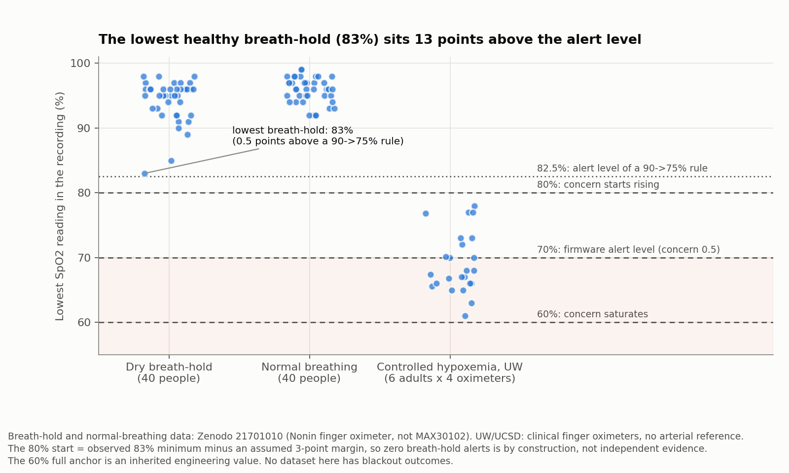
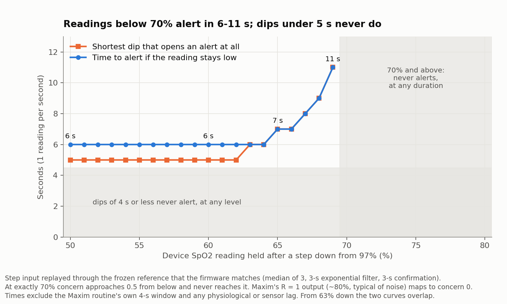
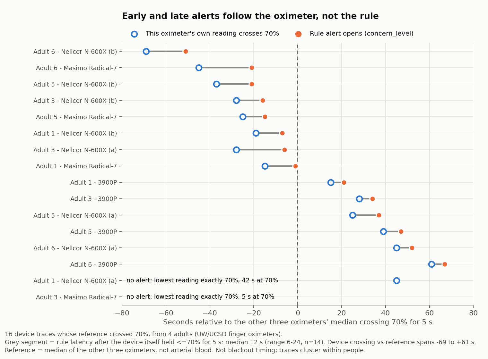
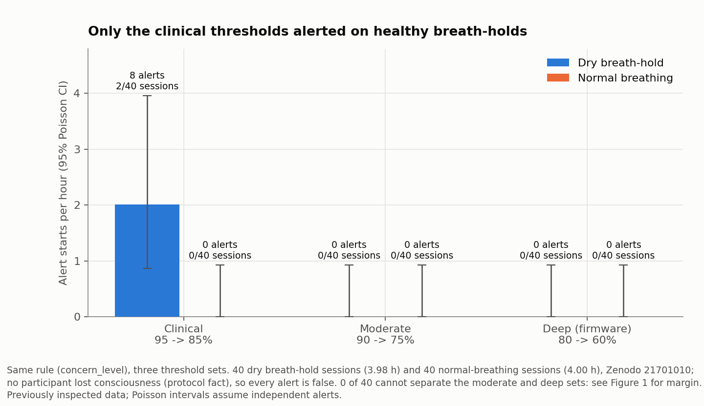

# Why the firmware oxygen rule is what it is

The device runs notebook 03's **`concern_level`** rule with the **80 → 60 %** anchors
(`Software/ppgSoftware/OxygenConcern.h`, configured in `FirmwareConfig.h`). Once per second
it takes the Maxim SpO₂ estimate and applies the following steps:

1. It takes the median of the last 3 readings.
2. It maps that median linearly onto a concern score: 80 % gives 0 and 60 % gives 1.
3. It smooths the score with a 3-s exponential filter.
4. It opens an alert once the smoothed concern has stayed ≥ 0.5 for 3 s.

The alert stays latched until the wearer acknowledges it. A concern of 0.5 corresponds to a
sustained reading of about **70 %**.

This page states what the evidence supports and what it does not. Every number below is regenerated by
[`tools/oxygen_rule_evidence.py`](../../../tools/oxygen_rule_evidence.py). It replays the frozen Python
reference (`Software/ppgSoftware/references/oxygen_reference.py`), and the C++ firmware matches that
reference on 651 golden rows. The script also checks its replay against notebook 03 v5's exported table
and stops if they disagree. The numbers are in [`numbers.json`](numbers.json).

**What none of this shows.**
- No dataset here has blackout outcomes.
- None was recorded with a MAX30102 on the chest, in water, or during exercise.
- All of it was inspected while the rule was being designed. The 80 % start anchor was set from
  the breath-hold data shown in Figure 1.
- These results support the rule's **behaviour and false-alert margin**. They do not support any
  claim that it detects or predicts blackout.

## Claim 1: the alert level sits 13 points below the lowest healthy breath-hold



| Evidence | Value |
|---|---|
| Lowest SpO₂ in 40 healthy dry breath-hold sessions (Zenodo 21701010, Nonin finger oximeter) | **83 %** |
| Lowest SpO₂ in 40 normal-breathing sessions | 92 % |
| Firmware alert level (concern 0.5) | 70 % |
| Alert level of the alternative 90 → 75 % ("moderate") rule | 82.5 %, only 0.5 points below the lowest breath-hold |
| UW/UCSD controlled hypoxemia, lowest reading per oximeter trace | 61–78 % |

**Defensible:** a healthy person's voluntary dry breath-hold in this study never came within 13 points of
the firmware alert level. The shallower 90 → 75 % rule would have had a 0.5-point margin.

**Not defensible:**
- **"80 % is a validated limit."** The start is the observed 83 % minus an *assumed* 3-point margin. That
  margin is not a measured MAX30102 error bound.
- **"60 % is a physiological limit."** The 60 % full anchor is an inherited engineering value.
- **"Zero breath-hold alerts is independent evidence."** Because the start was chosen from this data,
  zero alerts there is true by construction.

## Claim 2: brief artefacts cannot alert, and readings above 70 % never do



Step from 97 % to a constant reading, replayed through the reference:

| Reading held | Time to alert | Shortest dip that alerts at all |
|---|---:|---:|
| 50–62 % | 6 s | 5 s |
| 65 % | 7 s | 7 s |
| 69 % | 11 s | 11 s |
| **70 % and above** | **never** | **never** |

**Defensible (this is the rule's mathematics, not an empirical estimate):**
- A dip lasting **4 s or less never opens an alert**, however low the reading.
- A reading of **exactly 70 % never alerts**. Concern approaches 0.5 from below and never reaches it.
- Maxim's R = 1 output (about 80 %, the value its lookup returns for noise-like red/IR ratios) maps to
  concern 0, so this known artefact value cannot raise concern.

**Not defensible:** these times as end-to-end latency. They exclude the Maxim routine's own 4-s window,
sensor averaging, and the circulatory delay between lung and finger (or chest).

## Claim 3: with real desaturations, alert timing is set by the oximeter, not the rule



UW/UCSD controlled hypoxemia: 6 adults, 4 clinical finger oximeters each, recorded at 1 Hz. Each
oximeter is timed against the median of the other three crossing 70 %, held for 5 s.

| Evidence | Value |
|---|---|
| Traces whose reference crossed 70 % | 16, from **4** adults |
| Alerts on those traces | **14 / 16** |
| Alerts on the 8 traces whose reference did not cross | **0 / 8** |
| Rule latency after the oximeter's *own* reading held ≤ 70 % for 5 s | median **12 s** (6–24 s, n = 14) |
| Spread of oximeter crossing times against the reference | **−69 to +61 s** |
| The 2 traces without an alert | the lowest reading was **exactly 70 %** (42 s and 5 s at 70 %) |

**Defensible:**
- The rule adds about 6–24 s after the sensor itself reads below 70 %.
- Differences between oximeters spanned 130 s, about ten times the rule's median latency.
- Both traces without an alert are explained by Claim 2's boundary (exactly 70 % never alerts), not by an
  unexplained failure.

**Not defensible:**
- **"Detects 14/16 desaturations"** as a sensitivity figure. The 24 traces come from 6 people.
- **Accuracy against true blood oxygen.** The reference is the other oximeters, not arterial blood gas.
- **Blackout timing.** Nobody lost consciousness, and there is no blackout timing to compare against.

## Claim 4: only the clinical anchors alerted on healthy breath-holds



| Anchors (same rule) | Dry breath-hold alerts (3.98 h) | Normal-breathing alerts (4.00 h) |
|---|---:|---:|
| Clinical 95 → 85 % | **8** in 2/40 sessions (2.0/h, 95 % CI 0.87–3.96) | 0 |
| Moderate 90 → 75 % | 0 (upper 95 % 0.93/h) | 0 |
| **Deep 80 → 60 % (firmware)** | **0** (upper 95 % 0.93/h) | 0 |

All 80 participants stayed conscious (a protocol fact), so every alert counts as a false alert.

**Defensible:** clinical-hypoxemia thresholds produce false alerts during ordinary breath-holds.

**Not defensible:** that the data separates the moderate and deep anchor sets on false alerts; both had
zero. The case for 80 → 60 % over 90 → 75 % is the margin in Claim 1, not this chart.

## Claim 5: no tested alternative gives a measurable gain

Deep anchors, same data ([`variant_comparison_deep_anchors.csv`](variant_comparison_deep_anchors.csv)):

| Variant | Alerted, of 16 crossing traces | Alerted, of 8 non-crossing traces | Median alert vs reference | Healthy alerts |
|---|---:|---:|---:|---:|
| **`concern_level` (firmware)** | 14 | **0** | −3.5 s | 0 |
| `threshold` (no persistence) | 16 | 0 | −7 s | 0 |
| `threshold_persist` | 16 | 0 | +4 s | 0 |
| `concern_baseline` (person-relative) | 15 | 1 | −11 s | 0 |
| `concern_trend` (slope projection) | 16 | 2 | −30.5 s | 0 |
| `deficit_dose` | 16 | **4** | −119 s | 0 |
| Kalman level (v5) | 15 | 0 | −9 s | 0 |

**Defensible:**
- The trend and dose variants warn earlier only by also warning on traces that never crossed.
- The remaining differences are 1–2 traces from 4 people, too few to rank them.
- The firmware rule is kept because it is already ported and parity-tested, and nothing beats it
  measurably.
- Changing it after seeing these traces would be tuning to the outcome.

## Open decision (not changed in firmware)

The 70 % boundary is **exclusive** for `concern_level`, but **inclusive** (≤ 70 %) for the threshold
variants. With the Maxim routine's integer output, the firmware alerts at 69 % and below. Making it
inclusive would change both misses above into alerts. Any such change should be declared before new data
is collected, not justified by these traces. It is a one-line decision for the team.

## Reproduce

```powershell
python Software/GoogleColab/tools/oxygen_rule_evidence.py `
  --nb03 tmp/kaggle-qa/v6/out03_v5_final --uw tmp/kaggle-qa/model_a_source_cache/uw `
  --out Software/GoogleColab/results/2026-11-16/oxygen_rule
```

UW CSVs are checked against the MD5s pinned in notebook 03. Notebook 03 v5 outputs come from the
2026-11-16 local run (see [the run README](../README.md)).
